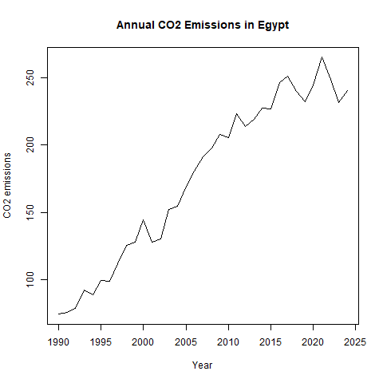
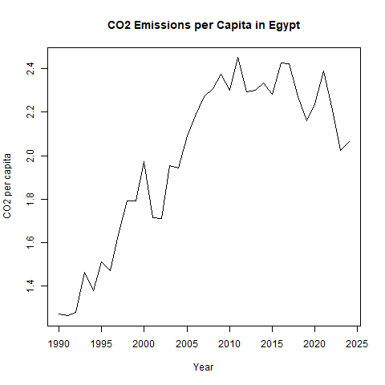
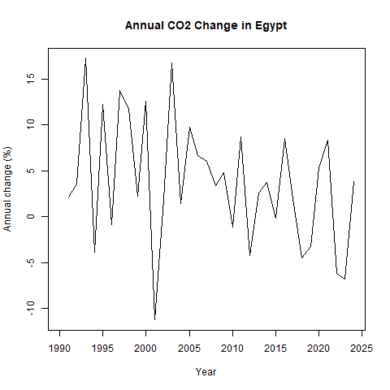

# Country-Level CO2 Emissions: Egypt

## 1. Country Information
- Country: Egypt
- ISO-3 Code: EGY
- Study Period: 1990–2024

## 2. Project Description
This project examines the annual carbon dioxide (CO2) emissions of Egypt from 1990 to 2024. The data were obtained from Our World in Data (OWID) and analyzed using RStudio. The main purpose is to describe the changes in Egypt's CO2 emissions over the study period.

## 3. Data Source
Our World in Data – CO2 and Greenhouse Gas Emissions:

https://owid-public.owid.io/data/co2/owid-co2-data.csv

## 4. Analysis and Interpretation

The analysis covers 35 years, from 1990 to 2024. Based on the results, Egypt recorded a mean annual CO2 emission value of 175.6241, while the total across the study period was 6146.843. These values represent the annual observations included in the dataset.

The annual CO2 emissions graph shows how Egypt's emissions changed over time. The per capita graph presents emissions in relation to the country's population, while the annual percentage change graph shows the year-to-year increase or decrease in emissions. Together, these graphs provide different ways to examine the country's emissions trend.

The results describe the pattern of CO2 emissions but do not explain the specific causes of the changes. Population growth, energy use, industrial activities, and other factors may influence emissions, but these were not tested in this analysis.

## 5. Analysis Outputs

The project contains the following outputs:

### Annual CO2 Emissions

### CO2 Emissions per Capita

### Annual Percentage Change

## 6. Limitations

This analysis is limited to Egypt and the available data from 1990 to 2024. It focuses on describing emissions trends and does not establish cause-and-effect relationships. The results also depend on the completeness and accuracy of the original dataset.

## 7. Tools Used
- RStudio
- R programming language
- Our World in Data

## 8. References

Our World in Data. (n.d.). CO2 and greenhouse gas emissions. https://ourworldindata.org/co2-and-greenhouse-gas-emissions
